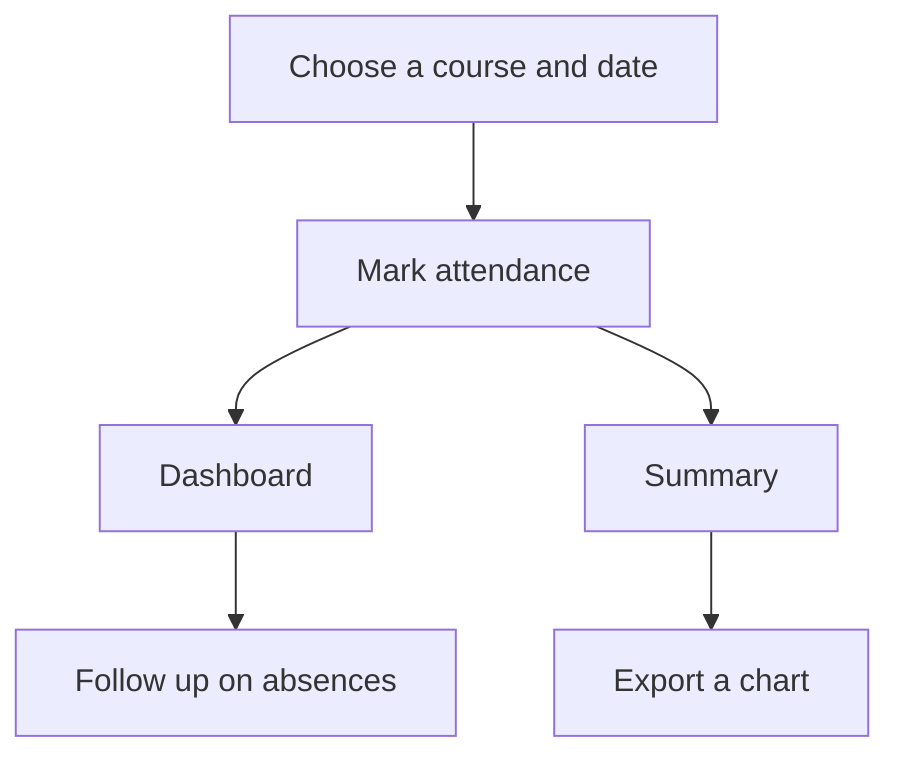
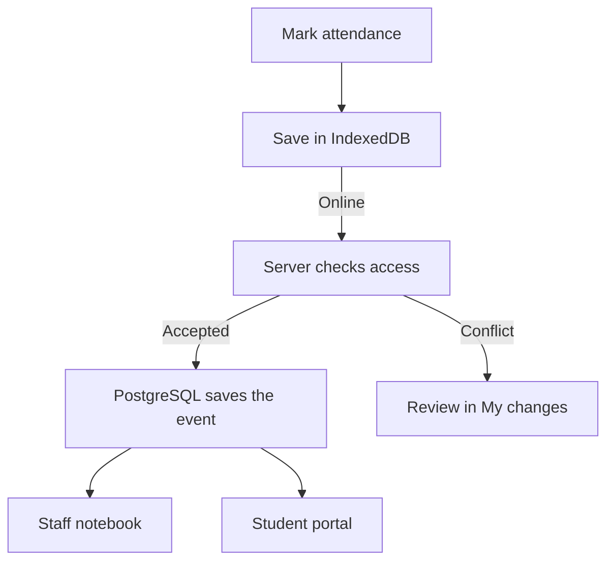

# Wartaq · وارتق

Wartaq is a bilingual website for Qur’an recitation courses. The public homepage introduces the course and its learning path. The private notebook gives staff a place to record attendance, keep tagged notes, and manage course progress. Students can check their own attendance by course and date.

[Visit the course homepage](https://wartaqi.up.railway.app/) · [Open the notebook](https://wartaqi.up.railway.app/?page=app)

The site works on phones and desktops, with English and right-to-left Arabic layouts. You can install the web app on supported devices. [Installation guide](docs/pwa.md)

## Who uses the notebook

An administrator sends an invitation. The recipient signs in with their verified phone number and a starter password, then sets their own password. [Account and role guide](docs/roles.md)

| Role              | What you can do                                                                                                                                       |
| ----------------- | ----------------------------------------------------------------------------------------------------------------------------------------------------- |
| **Administrator** | Invite users, manage the student register and teacher assignments, set up courses and enrollments, enter grades, correct records, and export reports. |
| **Teacher**       | Take attendance, add tagged notes, and update contact and profile details for active students assigned to you.                                        |
| **Student**       | Open **My attendance** to see your own recorded dates, course names, and current attendance marks.                                                    |

## From a class session to follow-up

Open **Attendance**, choose an open course and a session date, then tap **Present**, **Absent**, or **Excused**. Each tap saves on the device. Tap the selected status again to clear it. You can add a tagged student note from the same row, even if you leave attendance unmarked.



- **Dashboard** flags students with absences across the last six recorded sessions through the selected date. Open a student’s profile to find contact details and attendance history.
- **Summary** totals marks across the course and ranks dates by recorded absences. Export a PNG chart with numbered labels, highlight one student, or include names for the whole class.
- **Courses and grades** let administrators manage enrollment and keep practical and theory scores alongside attendance. Withdrawing a student preserves their recorded course level, marks, and grades. [Course workflow and Excel reports](docs/courses.md)

## How an attendance mark is saved

The React and TypeScript frontend runs as an installable web app. Rust serves the site, notebook API, OAuth and MCP on the same origin. Railway PostgreSQL stores the roster, enrollments, and attendance events.



Open the notebook online once to save the authorized roster on your device. Attendance and note edits can then queue offline. **Profile → My changes** shows pending changes and lets you resolve conflicts after reconnecting. An administrator’s correction adds a reversal to the history, preserving the original record. [Offline use](docs/pwa.md#offline-and-updates) · [Event and sync design](docs/architecture.md)

## Telegram and MCP

- **Telegram** provides a private chat for checking attendance and using available notebook tools. [Open @WartaqBot](https://t.me/WartaqBot) · [Telegram guide](docs/telegram.md)
- **MCP** lets a compatible client connect over Streamable HTTP with OAuth. The tools available depend on your Wartaq role and the scopes you grant. [MCP setup and tools](docs/mcp.md)

## Run it locally

Use Bun 1.3.0 for dependencies and Node.js 24 with npm 11 for scripts. The dev server opens the public site shell. For authenticated use, configure a disposable PostgreSQL database and serve the built app with Docker. [Local auth and database setup](docs/railway-setup.md)

```powershell
bun install --frozen-lockfile
npm run dev
```

Run `npm run verify` for repository checks and `npm run verify:ui` for synthetic browser coverage. [Contributing guide](CONTRIBUTING.md) · [Browser verification](.agents/skills/verify-halaqa/SKILL.md)

**Status** · v0.1.0 in development. Verified changes deploy from `main` to Railway. [Releases](docs/releases.md) · [Security](SECURITY.md)
