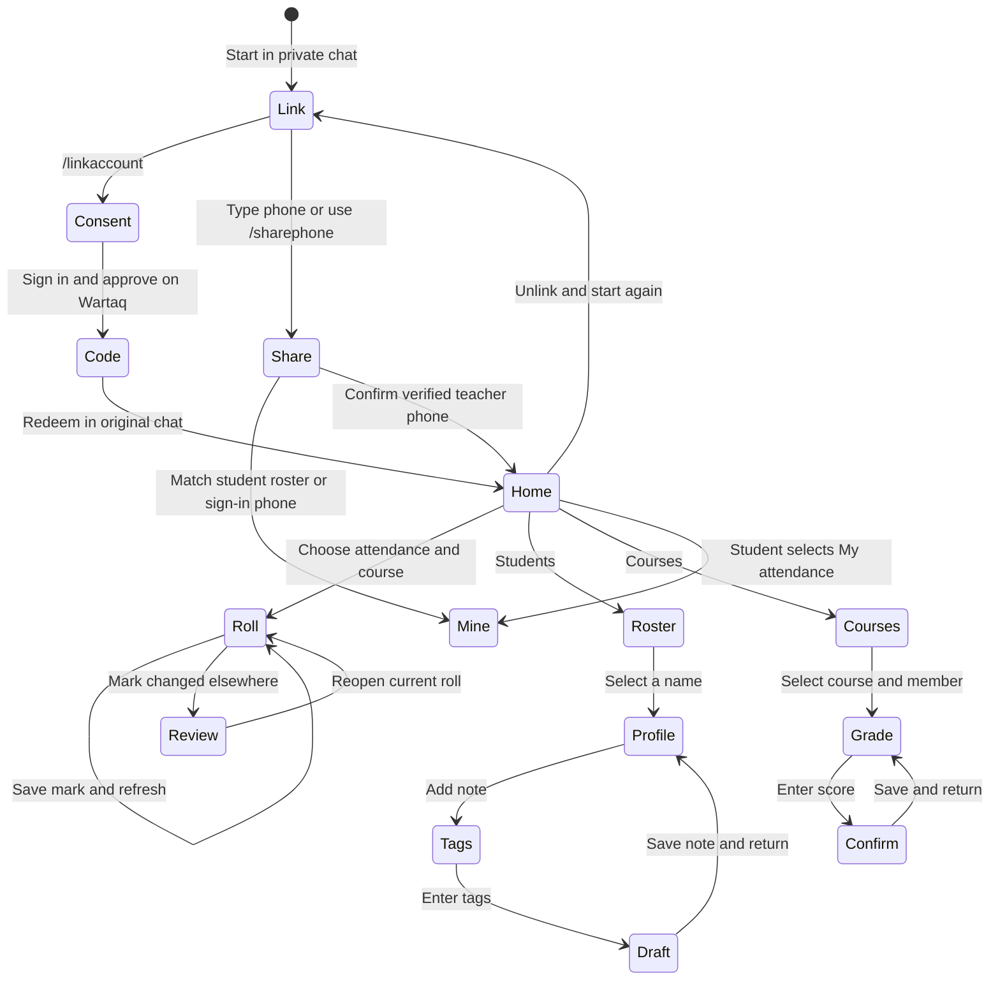

# Wartaq on Telegram

Open [@WartaqBot](https://t.me/WartaqBot) in a private chat and tap **Start**.

The private chat asks for your phone number. Enter it, then tap **Share my phone** to confirm it with Telegram. Syrian mobile numbers can use `09` or `+9639`. Send `/sharephone` to open the sharing button directly. Open the bot keyboard beside the message field if the button is hidden. When your Telegram number matches one active student record, **My attendance** opens without a Wartaq account or an additional verification step. If the number is missing or shared across active student records, ask your teacher to check it in the roster. Approved Teachers and Students can also use their verified Wartaq sign-in number. Teachers open the Teacher menu.

If you have trouble confirming your number or use an Administrator account, send `/linkaccount`. Tap **Link account** to open Wartaq in your browser, sign in and approve the connection. On the confirmation page, choose **Copy code**, then **Open Telegram**. Paste the eight digits into the same private chat and send them within five minutes. Returning to the bot or changing its language keeps the pending link. To discard it, use `/cancel`.

Choose a task from the buttons under the message. Type a reply when a screen asks for a name, date, grade or note. The bot follows Telegram's language on first use. The language button switches between Arabic and English. Use the Telegram menu to reopen the notebook, cancel an action or disconnect.

| From the menu      | What you can do                                                                                                                                                                                                                    |
| ------------------ | ---------------------------------------------------------------------------------------------------------------------------------------------------------------------------------------------------------------------------------- |
| Students           | Search the roster, view or edit a profile, add a tagged note, review history and correct an entry. Administrators can add students.                                                                                                |
| Take attendance    | Choose a course and date, then tap Present, Absent or Excused. The refreshed roll shows the saved mark and progress. A conflicting mark requires review.                                                                           |
| Attendance summary | View course totals, six-session follow-up and anonymous attendance charts. Student accounts open their own attendance directly.                                                                                                    |
| Courses            | Browse courses and memberships. Administrators can create, rename, close or reopen courses, set thresholds, enroll students, assign course teachers, record grades and decisions, track handbooks and download five Excel reports. |
| Accounts           | Administrators can search accounts, review access and invite someone after confirming their number. The invitation button opens the private one-time message on Wartaq.                                                            |
| My account         | View or change your display name. The profile button opens the website for photos, phone and password changes. Account access changes and password resets also open Wartaq.                                                        |

Teacher phone sign-in uses the same classroom tools and assignment permissions as [browser linking](mcp.md). Password changes open Wartaq in the browser. Student phone sign-in opens the student's own attendance in Telegram. Offline attendance, chart-image exports and device settings are available in the browser. A message already delivered to Telegram may remain visible after unlinking or withdrawal of access.

## Ask about Wartaq

Type a question directly in the private bot chat, such as **How do I take attendance?** or **كيف أسجّل الحضور؟**. You can ask how to link an account, use the menus or find a feature before signing in. The assistant gives instructions. Open `/menu` to view or change records through the usual account checks.

The bot sends ordinary chat text to the Wartaq operator's LM Studio host for inference. Commands, button actions and replies requested by an active sign-in or notebook workflow follow their usual paths. Use `/cancel` to exit an active workflow and ask a question. Keep passwords, link codes, phone numbers and student details out of questions. Use `/report <reference>` in the same private chat to flag an answer or a failure within 24 hours. Copy the reference from the bot reply.

## Editing a conversation

Each workflow returns a `Screen` with text, button rows and an optional next action for a typed reply. A button identifies the next route and its arguments. A workflow may return a new screen after a successful write. Telegram receives opaque button handles. The worker stores the route and arguments in its encrypted volume.



| To change                                           | Edit                                        | Verification                           |
| --------------------------------------------------- | ------------------------------------------- | -------------------------------------- |
| Home and available destinations                     | `telegram/menu.ts`, `telegram/routes.ts`    | Telegram integration and route tests   |
| Roster, attendance, notes or corrections            | `telegram/notebook/`                        | Telegram notebook tests                |
| Course details, memberships, grades or Excel files  | `telegram/courses/`                         | Telegram course tests                  |
| Profiles or invitations                             | `telegram/accounts/`                        | Telegram account tests                 |
| Button delivery, command handling or callback page  | `telegram/runtime/`                         | Telegram runtime tests                 |
| Browser linking, token refresh or permission checks | `telegram/auth.ts`, `telegram/transport.ts` | Telegram runtime and integration tests |
| Teacher and Student phone sign-in                   | `telegram/runtime/`, `server/index.ts`      | Telegram runtime and database tests    |

Add a destination to its workflow's route list and implement its screen. `Action.route` is derived from those lists, so misspelled button and prompt destinations fail type checking. Check the caller's available MCP tools before an action, and add a test that follows the real button or prompt through its side effect. Stored buttons from an older release can survive for fifteen minutes, so treat removed destinations as expired.

## Railway worker

`wartaq-telegram` runs one Bun process from `telegram/Dockerfile` in the AppSuite production project. Use the repository root as the build context, `main` as the source branch, Wait for CI, one replica and an always-on service. Attach a writable volume at `/data`. The public domain accepts the OAuth redirect at `/callback`. The worker receives Telegram updates through long polling. `/health` returns 200 after successful polling and 503 on a polling failure.

| Worker variable          | Value                                                  |
| ------------------------ | ------------------------------------------------------ |
| `TELEGRAM_BOT_TOKEN`     | BotFather token, supplied privately                    |
| `TELEGRAM_STORAGE_KEY`   | Base64-encoded 32 random bytes, supplied privately     |
| `TELEGRAM_WORKER_SECRET` | A separate random secret shared with the Wartaq server |
| `TELEGRAM_DB_PATH`       | `/data/bot.sqlite`                                     |
| `WARTAQI_ORIGIN`         | `https://wartaqi.up.railway.app`                       |
| `TELEGRAM_PUBLIC_ORIGIN` | `https://wartaq-telegram-production.up.railway.app`    |
| `PORT`                   | `3000`                                                 |

Use canonical HTTPS origins without a trailing slash. The worker needs no application database URL or website signing secret. It registers an OAuth client, uses PKCE, and binds each login to the initiating chat and a browser-issued code. SQLite encrypts stored values with AES-256-GCM. Back up the volume and storage key privately as a pair. Losing either requires users to reconnect.

Set `TELEGRAM_WORKER_SECRET` on the `wartaqi` service and reference it from `wartaq-telegram` to enable phone sign-in. Use at least 32 random bytes encoded as base64url. Telegram phone sessions expire after 30 days.

The worker claims each Telegram update before handling it. After an interruption or uncertain write, reopen the record to check its state. Buttons expire after fifteen minutes and are tied to their user, private chat and message. The bot edits the open message as you navigate. `/unlink` clears local access and requests provider revocation.

To restore the Telegram command menu and both public descriptions, run `bun scripts/configure-telegram.ts` with the bot token in the private environment. Use a separate bot identity for local long polling. Run `bun run verify:release` and build the worker with `docker build -f telegram/Dockerfile .`. A migrated disposable `TEST_RAILWAY_DATABASE_URL` enables the actual OAuth, role-switching and roster-write test.

### Assistant setup and diagnostics

Configure `LM_STUDIO_BASE_URL` with the inference tunnel's HTTPS URL ending in `/v1`, `LM_STUDIO_MODEL` with `prism-ml/bonsai-27b`, and `LM_STUDIO_API_KEY` with the proxy bearer token. Set them on `wartaq-telegram` in `production`. Pass the token through Railway's private variable input. The Windows host must be online with LM Studio and the tunnel running. Removing the three variables disables inference.

Use the reply reference to find the matching structured events in the worker's [Railway deployment logs](https://docs.railway.com/observability/logs). For example, replace `REFERENCE` in this command with the value from Telegram.

```powershell
railway logs --service wartaq-telegram --environment production --since 24h --filter '@trace:REFERENCE'
```

Read the inference outcome and delivery outcome together. The events record the prompt version, configured model, timing, provider status and token usage when available. User reports add a feedback event to that trace. The worker's diagnostics exclude questions, replies, chat identities, credentials and provider error bodies. To reproduce an issue, use a synthetic question that describes the same workflow.

When inference is configured, the worker logs a synthetic probe at startup. Check this outcome after a deployment. Telegram polling health is available independently at `/health`. To run the same check on demand from the linked AppSuite project, use `railway ssh --service wartaq-telegram --environment production -- bun /app/bot.js --assistant-smoke`. The check emits a trace, makes no Telegram calls and exits with a failure status if it cannot get a usable answer.

To roll back a bot release, redeploy the previous successful worker image or take only the bot service offline. Keep its volume. Changes users already saved through Wartaq follow the website's normal correction and management workflows.
